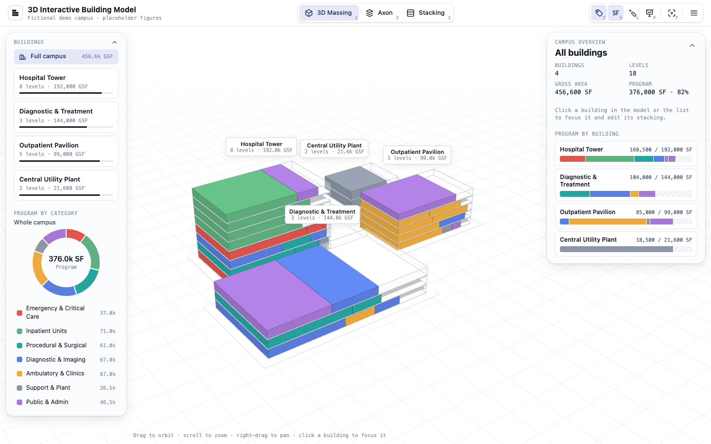
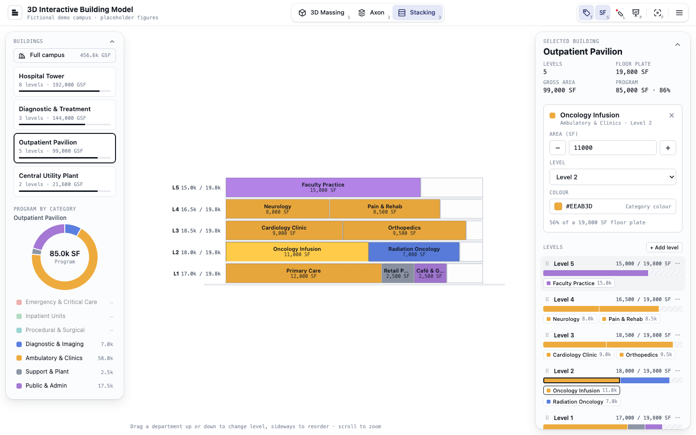

# 3D Interactive Building Model

Interactive massing and stacking diagrams for presenting a medical campus program to clients. Load a program from Excel, stack its departments level by level, and walk the room through it in 3D.

**[Open the live demo →](https://hongyyu.github.io/3d-interactive-building-model/)**



## Contents

- [Quick start](#quick-start)
- [Views](#views)
- [Editing the stack](#editing-the-stack)
- [Presenting](#presenting)
- [Keyboard shortcuts](#keyboard-shortcuts)
- [Use your own program](#use-your-own-program)
- [Development](#development)
- [License](#license)

## Quick start

1. Open the [live demo](https://hongyyu.github.io/3d-interactive-building-model/), or [run it locally](#run-locally).
2. On the start screen, choose **Explore the demo** to try a fictional campus, or **Import Excel program** to load your own.
3. Click a building to focus it, then switch views with `1`, `2` and `3`.
4. Drag departments between levels. When you're done, choose **Print report (PDF)…** from the ☰ menu.

The icon left of the title brings the start screen back.

## Views

| View | Key | What it shows |
|---|---|---|
| **Campus overview** | — | Every building with its departments in colour, and campus totals on the right. Every project opens here. |
| **3D Massing** | `1` | Perspective master plan. Click a building to focus it. |
| **Axon** | `2` | Exploded, near-orthographic axonometric of the focused building. |
| **Stacking** | `3` | Flat elevation stacking diagram of the focused building, its levels stacked without gaps. |

- Department volumes scale with area (SF) relative to the floor plate. Unused floor area shows as a translucent void, and a level whose program is larger than its floor plate is flagged as over capacity.
- To focus a building, click it, its tag or its card in the left panel. **Full campus**, at the top of the Buildings list, returns to the overview.
- **Navigate:** drag to orbit, scroll or pinch to zoom, and right-drag or Shift-drag to pan. In Stacking, dragging empty space pans.
- **Labels:** each department's label shows its name and SF on two lines, in every view. In Axon it is centred on the department's side face, on every level alike, and each level's area summary sits left of the building. On a floor too thin on screen for two lines, the label's text shrinks to fit (down to 75%); thinner still, it shows the name only until you zoom in. Zooming in makes the labels and tags grow, up to 1.6×, so they stay readable on a projector; they never shrink below their normal size.



## Editing the stack

**Departments**
- **Move:** drag a department to another level or position. In Stacking, drag up or down to change its level and sideways to reorder. Escape cancels the drag.
- **Edit:** click a department to open its card in the right panel. Change its area with − / + or by typing, pick a level, or change its colour.
- **Unassigned tray:** departments without a level wait in the right panel. Select one and pick a level to place it in the focused building.

**Levels** (right panel)
- **Reorder:** drag a level by its grip, or focus the grip and press ↑ ↓. The building follows as you drag, and Escape cancels.
- **Insert or remove:** each level's ⋯ menu inserts an empty level above or below it, or removes it. A removed level's departments go to the Unassigned tray.
- **+ Add level** puts an empty level on top.

**Colours**
- Click a category swatch in **Program by category** (left panel), or a department's Colour field, to open the colour panel. Pick from the palette or the colour area, or type a hex code. Changes apply at once.
- A department with its own colour can go back with **Use category colour**.
- **Reset colours** (left panel) restores the loaded colours.

**Other**
- **Program by category:** the donut shows each category's share of the campus, or of the focused building. Hover a slice or a legend row to see its area and share and make its departments glow in the model. Hovering a department in the model lights its category on the donut.
- **Highlight a category:** click its slice or its name in **Program by category** to fade everything else. Click it again to clear.
- **Hide details:** the chevron next to the building name folds the right panel down to its title.
- **Hide buildings:** the chevron next to **Buildings** folds the building cards away, leaving more room for **Program by category**.
- **Reset layout** (☰ menu) restores the loaded levels, areas and placements. It leaves colours alone.

## Presenting

| Tool | Key | What it does |
|---|---|---|
| **Present** | `P` | Hides both side panels so the model fills the screen. |
| **Labels** | `T` | Shows or hides department labels. |
| **SF on labels** | `S` | Adds or removes each label's SF line. Like **Labels**, it applies to every view. |
| **Laser pointer** | `L` | Drag on the model to draw a red line that fades within two seconds, so the room can follow along. The model stays still; right-drag still pans and the wheel still zooms. `L` or Escape turns it off. |
| **Reset view** | `F` | Reframes the camera. |

**Print report:** choose **Print report (PDF)…** from the ☰ menu, or press `Ctrl+P` / `⌘P`. Then choose **Save as PDF** in the print dialog. The report covers the whole project:

- **Summary page:** campus totals, a picture of the current view, the buildings, the program by category and the Unassigned tray.
- **One page per building:** a stacking diagram, then every department level by level, with SF, share of the floor plate, notes and over-capacity flags.

## Keyboard shortcuts

| Key | Action |
|---|---|
| `1` `2` `3` | 3D Massing, Axon, Stacking |
| `T` | Labels on / off |
| `S` | SF on labels on / off |
| `L` | Laser pointer on / off |
| `P` | Present mode on / off |
| `F` | Reset view |
| `Esc` | Cancel a drag, close a menu, or turn the laser off |
| `↑` `↓` | Move the level whose grip has focus |
| `Ctrl+P` / `⌘P` | Print report |

Shortcuts are ignored while you type in a field or while a dialog is open. Each toolbar button shows its key in the corner and a tooltip on hover.

## Use your own program

1. **Download the template:** choose **Download template** from the ☰ menu (or **Download the Excel template** on the start screen). You get an Excel workbook pre-filled with the fictional demo campus. It has four sheets:

   | Sheet | Columns (\* required) |
   |---|---|
   | **Instructions** | How to fill in the workbook |
   | **Program** | Department\*, SF\*, Category, Building, Level, Color, Notes |
   | **Buildings** | Building\*, Width ft\*, Depth ft\*, Floor-to-floor ft\*, Levels\*, Site X ft, Site Z ft |
   | **Categories** | Category, Color |

2. **Fill it in:** replace the example rows with your own. Building and Category cells have dropdowns. Leave Level blank for any department you want to place later.
3. **Import it:** choose **Import program…** from the ☰ menu (or **Import Excel program** on the start screen) and pick the file. You can use an `.xlsx` workbook, or a `.csv` with just the Program columns; a CSV keeps the current buildings and categories.
4. **Check and load:** a summary lists what was read and any rows with problems. **Replace project** loads it.

Departments without a building or level wait in the **Unassigned** tray. **Reset layout** returns to the imported layout, and **Load demo project** (left panel) brings back the demo.

## Development

### Run locally

Needs Node 20.19+ or 22.12+.

```sh
npm install
npm run dev       # dev server at http://localhost:5173, reloads on save
npm run build     # production build into dist/
npm run preview   # serve dist/ locally
```

`dev` and `build` first regenerate the Excel template (`npm run template`).

| Path | What's there |
|---|---|
| `src/` | The app: `data/` (demo and importer), `layout/` (stacking), `scene/` (Three.js), `ui/` (panels and input) |
| `scripts/build-template.mjs` | Builds the Excel template from the demo |
| `tests/` | Visual regression test, baselines and fixtures |
| `CLAUDE.md` | Architecture notes |
| `FEATURE_PLAN.md` | Roadmap |

Three.js is pinned to r128 until the Phase 3 upgrade in the roadmap.

### Visual regression test

```sh
npx playwright install chromium   # first time only
npm run test:visual               # build, then run every test in headless Chromium
```

| Test | What it checks |
|---|---|
| **Demo scenario** | Replays 32 steps: view modes, selection, area edits, dragging, camera moves, reset, present mode and a narrow window. Each step compares a stage screenshot and a text snapshot of the panels with the baselines. |
| **Template round trip** | Downloads the template and imports it back; the model must render exactly like the demo. |
| **CSV import with problems** | Imports `tests/fixtures/program-with-issues.csv` and checks the import summary and the Unassigned tray. |
| **Rejected file** | A file with the wrong columns can't be loaded. |
| **Start screen, levels and laser** | Imports from the start screen and returns to it, adds and removes levels, resets the layout, and checks that the laser draws only while dragging. |
| **Printed report** | Checks the report's text and pages, then overfills a level, sends a department to the tray, and checks that a second print shows both. |
| **Toolbar shortcuts and menu** | Keyboard shortcuts, the Labels and SF settings across views, that shortcuts are ignored while typing, and the ☰ menu from the keyboard. |
| **Level editing** | Reorders levels by dragging and with the arrow keys, cancels a drag with Escape, inserts and removes levels, and folds the right panel and the Buildings list. |
| **Category donut** | Hovers a slice, a legend row and a department in the model, and checks that the donut, the legend and the model light the same category. Clicking a slice isolates it. |
| **Colour panel** | Recolours a category from the palette, the colour area and the hex field, then a department. Checks Escape, outside clicks and **Use category colour**, and that **Reset colours** restores the demo's look. |

**After an intended visual change:** review the failures with `npx playwright show-report`, re-record the baselines with `npm run test:visual:update`, and commit them.

The baselines in `tests/visual.spec.js-snapshots/` were rendered on macOS; other platforms need their own. The screenshots in this README are two of them, so they update when the baselines are re-recorded.

### Deployment

Every push to `main` deploys to GitHub Pages through `.github/workflows/pages.yml`, which runs `npm run build` and publishes only `dist/`. To redeploy without a new commit, run the workflow manually from the Actions tab.

## License

Proprietary and confidential. Copyright (c) 2026 Hongyu Li and Zining Cheng. All rights reserved.

No use, copying or distribution without written permission; see [LICENSE](LICENSE). Third-party packages keep their own licenses.
